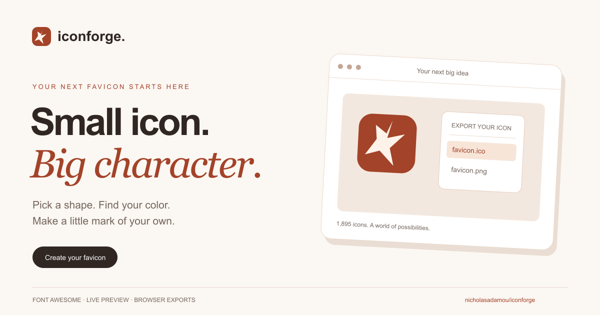

<p align="center"></p>

# IconForge

Small icon. Big character. Create favicons with 1,895 Font Awesome icons, live color and size controls, stacking, and browser-based PNG and ICO exports.



[](https://github.com/nicholasadamou/iconforge/actions/workflows/ci.yml)
[](https://github.com/nicholasadamou/iconforge/releases)
[](https://nextjs.org)
[](https://www.typescriptlang.org)
[](https://bun.sh)
[](https://flox.dev)
[](LICENSE)

## Run locally

```sh
flox activate
bun install --frozen-lockfile
bun run hooks:install
bun run dev
```

Open `http://localhost:3000`. No API key is needed for normal exports.

## Documentation

Start with [docs/](docs/README.md): [quick start](docs/quick-start.md), [customization](docs/customization.md), [exports](docs/exporting.md), [development and CI](docs/development.md), and [architecture](docs/architecture.md). The same guides are available at `/docs` in the app.

Run `bun run check`, `bun run test:ci`, and `bun run verify:production` before pushing. Local hooks mirror CI, including Markdown, Mermaid, and LOC budgets. Successful main CI produces patch releases automatically.

[License](LICENSE) · [Credits and privacy](docs/credits.md)
