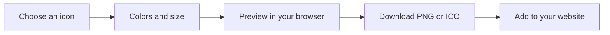

# Overview

A small workshop for your next favicon. IconForge turns Font Awesome icons into a mark you can customize and download in your browser.

## Make the smallest detail count

Search 1,895 icons, choose a foreground and background color, and adjust the scale. A live canvas shows your changes. Stack a second icon for a cutout effect, then export the result.

## Start with a shape

Follow the [quick start](quick-start.md) to create your first favicon. Learn about [colors and stacking](customization.md), then choose an [export format](exporting.md).

## Run it yourself

IconForge is a Next.js application with no database or account requirement. See [local development](development.md) for the Flox environment, Bun commands, and checks. The [architecture guide](architecture.md) explains how the editor works.

## Your work stays in the browser

Normal editing and PNG/ICO downloads happen locally. The optional advanced export sends your image to RealFaviconGenerator only when you choose it. Read [credits and privacy](credits.md) for assets, licenses, and data handling.
