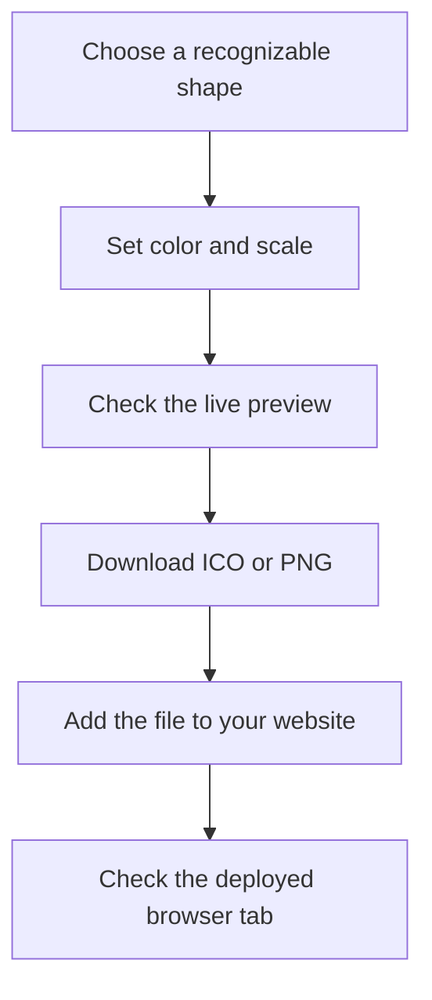

# Overview

IconForge is a small browser-based workshop for creating a favicon: the mark people see beside your website’s title in a browser tab. Start with a Font Awesome shape, adjust its appearance, and download an image you can add to your own site.

## What you can make

The studio provides a searchable catalog of 1,895 icons, foreground and background colors, size controls, and an optional second shape. You do not need an account, a design file, or an API key for normal ICO and PNG exports.

A favicon works at very small sizes. A simple silhouette is usually easier to recognize than a detailed illustration. The live preview gives you room to work, but check your downloaded design in a real browser tab before considering it finished.

## Find the right guide

| What you want to do                                | Start here                            |
| -------------------------------------------------- | ------------------------------------- |
| Create and install your first favicon              | [Quick start](quick-start.md)         |
| Adjust colors, transparency, or stacked shapes     | [Colors & stacking](customization.md) |
| Choose a format and integrate it into a site       | [Exporting favicons](exporting.md)    |
| Diagnose a blank image or an unchanged browser tab | [Troubleshooting](troubleshooting.md) |
| Run IconForge locally or contribute a change       | [Local development](development.md)   |
| Understand rendering, exports, and releases        | [How it works](architecture.md)       |
| Understand licensing and external services         | [Credits & privacy](credits.md)       |

## Get oriented in the studio

Open the [studio](/studio). On a desktop, the left panel contains your preview, appearance controls, and download buttons. The right panel contains search and the icon library. The workspace fills the viewport; the icon list scrolls inside its panel rather than moving the whole page.

On a phone, use **Choose an icon** to browse, then **Customize & export** to see the preview and controls. Switching between these panels keeps your current design. On short screens, the controls can scroll internally so every option remains reachable.

Search for a concept such as `leaf`, `coffee`, or `code`. Select a result to use it. The library initially shows a portion of the catalog; **Show more icons** loads another batch. An empty search result does not change the icon already in your preview.

## Understand what is saved

The current design exists in the open studio’s memory. There is no project account, saved-design library, undo history, or import workflow. Refreshing or leaving the studio resets its state. Switching the mobile panels does not.

Download your result before navigating away. A PNG or ICO export is a finished image, not an editable IconForge project. If you want to recreate a design later, also record the selected icon names, color values, sizes, and whether stacking was enabled.

## Choose local or external export

Normal ICO and PNG downloads are generated in your browser. Advanced ICO export is a separate integration that opens RealFaviconGenerator and sends it the current image. It requires configuration by the person hosting IconForge.

Downloading a file does not install it on your website. You still need to place it in your website’s public files, reference it, deploy the change, and check the result. The [export guide](exporting.md) includes examples for those steps.

## Run your own copy

IconForge is a Next.js application with a Flox-managed development environment and Bun-managed dependencies. It does not need a database. Follow [local development](development.md) for installation, browser-test setup, and the same checks used in CI.
