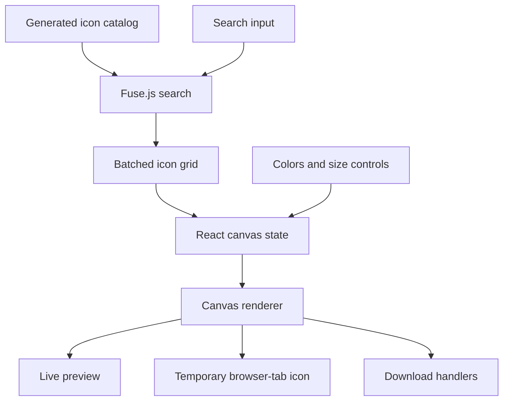
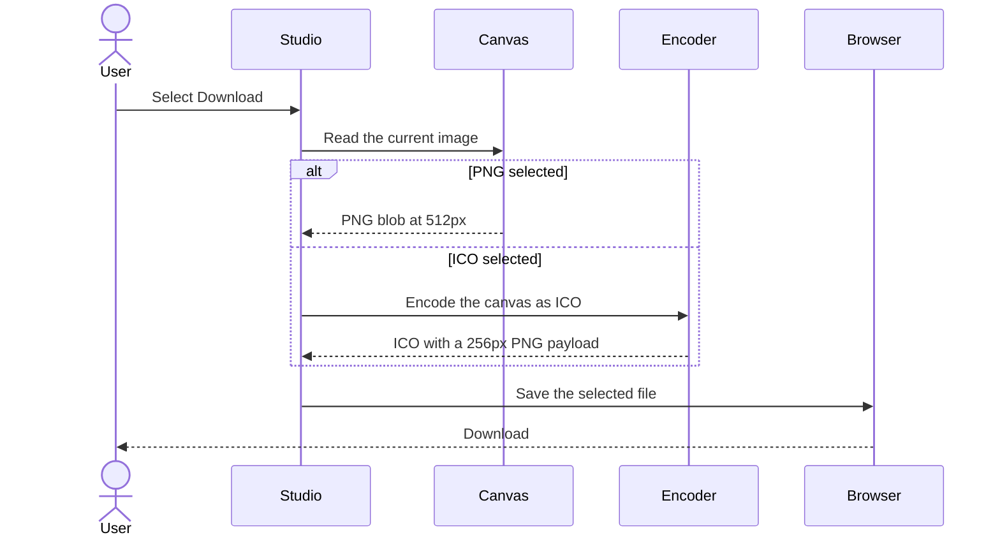
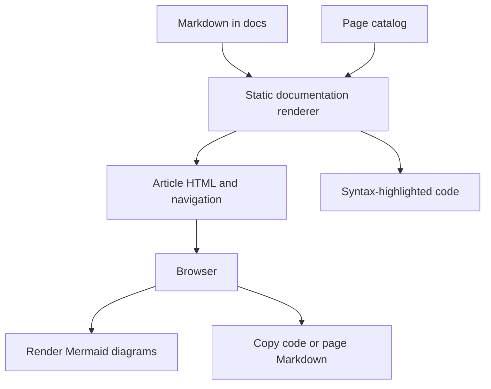
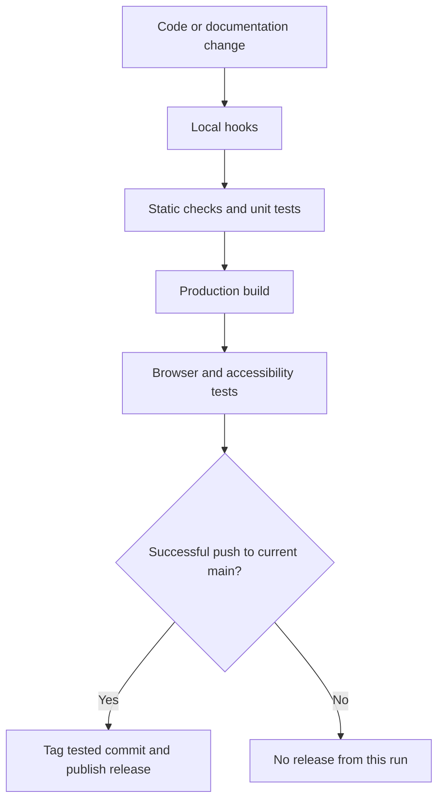

# How it works

IconForge separates a server-rendered marketing and documentation site from a client-side favicon editor. The application has no design database or design-upload endpoint; normal image creation happens in the browser.

## Routes and responsibilities

The homepage at `/` explains the product and links into `/studio`. The studio owns the editable canvas state. Documentation routes under `/docs` read Markdown from the repository and are generated from a small page catalog.

| Route                      | Purpose                                       | Main implementation             |
| -------------------------- | --------------------------------------------- | ------------------------------- |
| `/`                        | Marketing content and studio entry points     | `app/page.tsx`                  |
| `/studio`                  | Search, appearance controls, preview, exports | `app/studio/page.tsx`           |
| `/docs` and `/docs/[slug]` | User and contributor guides                   | `app/docs/[[...slug]]/page.tsx` |

The studio uses its own compact toolbar rather than the marketing header and footer. Its layout is bounded by the viewport. On small screens, panel switching exposes the library or the controls without turning the workspace into a long document.

## Editor state and search

The studio stores the primary icon, secondary icon, foreground color, background color, two size values, and stacking state in React state. Appearance controls update that state directly. A library selection updates either the primary or secondary icon depending on whether stacking is enabled.

Search filters the full catalog. The grid displays results in batches to avoid rendering every icon button at once. The current design is separate from search state, so an empty search does not clear the preview.

State is not persisted to a server, local storage, or a project file. Leaving the studio destroys that editing session. Mobile panel switching changes presentation while retaining the same mounted studio state.

## Canvas rendering

`components/IconCanvas.tsx` waits for `document.fonts.ready`, then calls `drawIcon` from `lib/canvas-utils.ts`. Drawing uses a 512 × 512 canvas, the selected Font Awesome font family, a weight appropriate to the selected icon, and centered text placement.

The renderer clears the canvas, applies a background fill when requested, and draws the primary glyph. If stacking is enabled, it draws the second glyph using XOR composition. Overlap therefore becomes transparent instead of creating an ordinary painted layer.

The checkerboard is a CSS background behind the canvas, not part of the exported bitmap. The dynamic favicon hook reads the rendered canvas to update the current browser tab’s icon; it does not write a file or update any other website.

## Local export sequence

`useDownload` chooses the encoder based on the format selection. PNG uses the canvas blob directly. ICO creates a 256 × 256 PNG image and writes an ICO header and directory entry around its bytes before saving the file.

The download hook exposes progress and error state to the UI. A missing canvas or an encoding failure produces a visible error instead of pretending a file was created. Browser tests inspect the ICO header and embedded PNG dimensions in addition to checking the downloaded filename.

## External integrations

Advanced export is the exception to local image processing. The hook builds a form containing the current image and browser-visible integration key, posts it to RealFaviconGenerator, and targets a new tab. The external service owns the remainder of that workflow.

Documentation chat links are separate from image export. They encode the current page’s Markdown into a provider URL and open that URL in a new tab. They do not include the canvas image or automatically send a chat message. See [credits and privacy](credits.md) for the data boundaries.

## Documentation rendering

The documentation catalog supplies route metadata and navigation order. The server reads the corresponding Markdown, extracts H2 headings for the table of contents, and renders links, sections, tables, and code blocks through React Markdown. Unknown page slugs return a 404.

Syntax highlighting is performed on the server using registered language grammars. Only the highlighted markup reaches the page; the highlighter does not need to run in the browser. Copy buttons remain small client components and receive the untouched source text.

Mermaid loads in the browser for diagram blocks. Its strict security mode is enabled, and the Markdown source remains available even if a diagram cannot render. CI separately parses every Mermaid fence to catch invalid syntax before deployment.

## Bundled assets and compatibility

Font Awesome fonts and DM Sans are served with the application rather than requested from a third-party font CDN at runtime. The catalog retains 1,895 entries generated from Font Awesome 6.5.2 metadata; the installed compatible version 6 package supplies their glyphs.

The canvas renderer explicitly uses Font Awesome 6 font-family names. A future major-version migration must check the renderer, generated catalog, CSS classes, glyph values, tests, and user-facing counts together. The logo and social image are repository assets in `public/`.

## Quality checks and releases

Both local hooks and CI use the Flox toolchain and Bun scripts. The release workflow consumes the result of CI and verifies the commit identity before tagging. This prevents a successful check for an older revision from being treated as validation of newer code. See [local development](development.md) for the exact commands.
