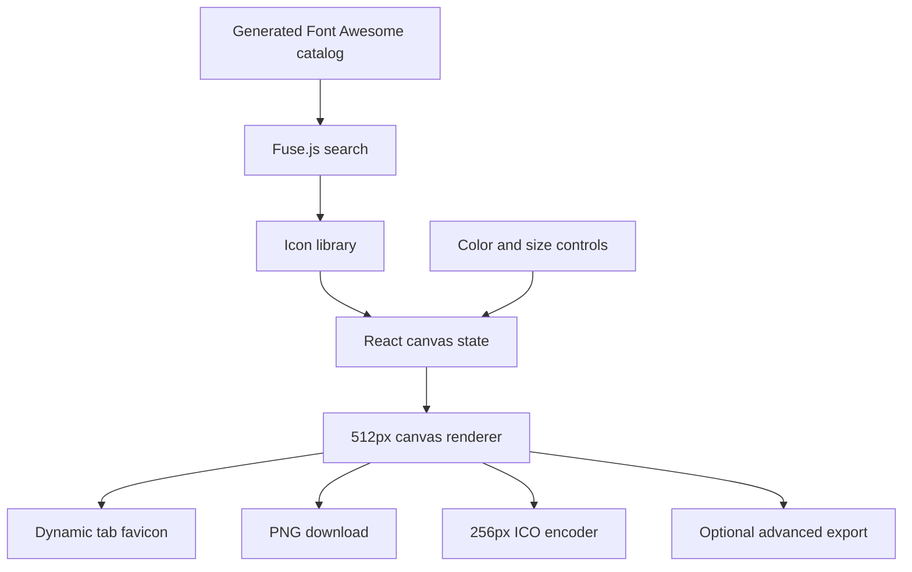
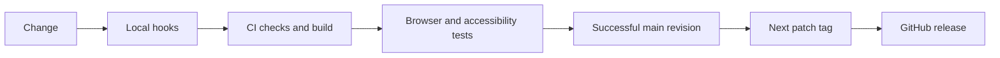

# How it works

IconForge is a browser editor served by Next.js. There is no application database or upload endpoint.

## Editor data flow

`app/page.tsx` owns editor state. Components present controls; hooks handle search, downloads, and the dynamic favicon. `lib/canvas-utils.ts` draws the canvas, and `lib/ico.ts` packages a PNG inside an ICO container.

## Documentation

Markdown files in `docs/` are the source for the website’s docs routes. A small route catalog defines titles and navigation. React Markdown renders the content, with Mermaid loaded only for diagrams. Unknown slugs return a 404.

## Assets

Font Awesome 6.5.2 matches the generated catalog in `lib/icons.ts`. Fonts are bundled locally so the editor does not depend on a runtime font CDN. The SVG brand mark and social image live in `public/`.

## Quality and release flow

Auto-release only tags the exact successful CI revision, and skips it if main has moved. Branch and pull-request CI never releases. See [development](development.md) for commands and budgets.
