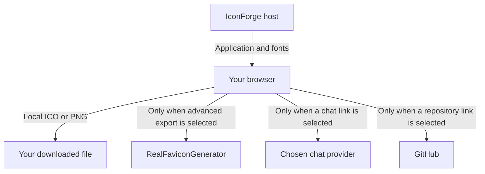

# Credits & privacy

The tools and assets behind IconForge, and what happens to your data.

## Project license

The repository uses the exact license text in [LICENSE](https://github.com/nicholasadamou/iconforge/blob/main/LICENSE): PolyForm Shield License 1.0.0. Read that file for its terms and notices. This is not an MIT-licensed project.

## Icons and fonts

[Font Awesome Free](https://fontawesome.com/license/free) supplies the icon collection and brand glyphs: icons use CC BY 4.0, fonts use SIL OFL 1.1, and code uses MIT. Upstream notices remain in the installed package. The chat-provider SVG marks are adapted from the convrt reference assets. Brand marks belong to their respective owners; inclusion is not an endorsement.

DM Sans is bundled through Fontsource under SIL OFL 1.1. The IconForge spark mark and social illustration were created for this project using SVG.

## Interface references

Navigation and footer styling adapt the [Smeltery Skills](https://github.com/smeltery/skills) interface. Documentation layout and social-image composition reference [convrt](https://github.com/smeltery/convrt). Their PolyForm Shield notices apply to adapted material; copyright 2026 Smeltery and the respective contributors. IconForge uses its own branding and project-specific content.

## Data handling

Editing, search, live preview, and normal PNG/ICO exports run in your browser. There is no account system, application database, analytics script, or design upload for those features. Fonts are served with the application.

Advanced export sends the current canvas image to RealFaviconGenerator when you choose that option. Its service terms and privacy policy apply there. GitHub links take you to GitHub. Your hosting provider may keep ordinary request logs; this application does not configure their retention policy.

Opening a chat-provider link shares the current documentation text in that provider’s URL. It opens a new tab; IconForge does not send a chat message automatically.

## Where data travels

The application serves its HTML, JavaScript, styles, and fonts from the configured host. Your browser uses those assets to search and render icons. Local downloads do not require uploading the design to an application server.

The external export receives the current image. A chat link receives the documentation text for the current page, not the image being edited. Repository and help links navigate to their named services. Each external service applies its own policies after you choose to use it.

## Understand the limits of local state

Keeping editing state in the browser does not provide persistent storage. IconForge does not save projects to local storage or an account, and there is no server-side recovery flow for a closed tab. Download your image and record its settings if you need to keep the result.

Local processing also does not mean the website makes no network requests at all. Loading the site requires requests to its host, and ordinary infrastructure request logs may exist. Browser extensions, organizational browser policies, and the services you explicitly open operate outside this application’s control.

## Attribution when reusing the project

Keep the project license and applicable third-party notices with redistributed material. Font Awesome’s icon, font, and code licenses cover different asset types; do not assume one license applies to every file. Brand logos identify their owners and do not imply a partnership with IconForge.

If you change or replace an asset, update this guide alongside the asset so the documented provenance remains accurate. For licensing terms, use the linked license texts rather than treating this guide as a replacement for them.
