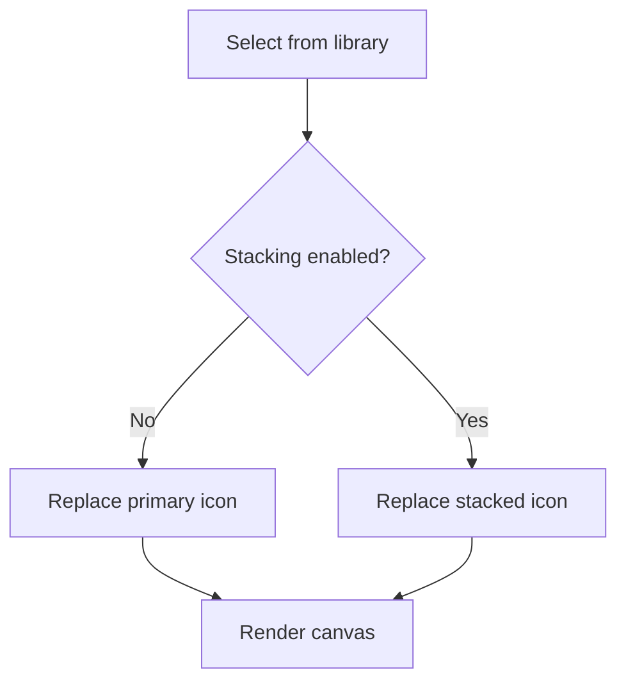

# Colors & stacking

Use color, scale, and a second shape to make an icon your own.

## Foreground and background

**Icon Color** controls the glyph. **Background Color** controls the canvas behind it. Select a swatch to open the color picker or enter a hexadecimal color. Transparent background removes the background fill, so your icon can sit on any page color.

## Scale

The size sliders range from 10% to 100% of the 512-pixel canvas. Leave some breathing room: large glyphs can touch or extend beyond the canvas edge. Preview your icon at small sizes before using it in a browser tab.

## Stack a second shape

Enable **Stacked Icon**, then select another icon from the library. While stacking is enabled, library selections change the second icon. Disable stacking to change the primary icon again.

Stacking uses the canvas XOR composition mode: overlapping areas become transparent. It is a cutout effect, rather than a separate colored layer. **Stacked Size** adjusts the second shape independently.

## Preview limitations

The canvas updates while you work, and the browser tab icon follows it. Your changes live in memory: refreshing the page resets the editor. Download your finished design before leaving.
