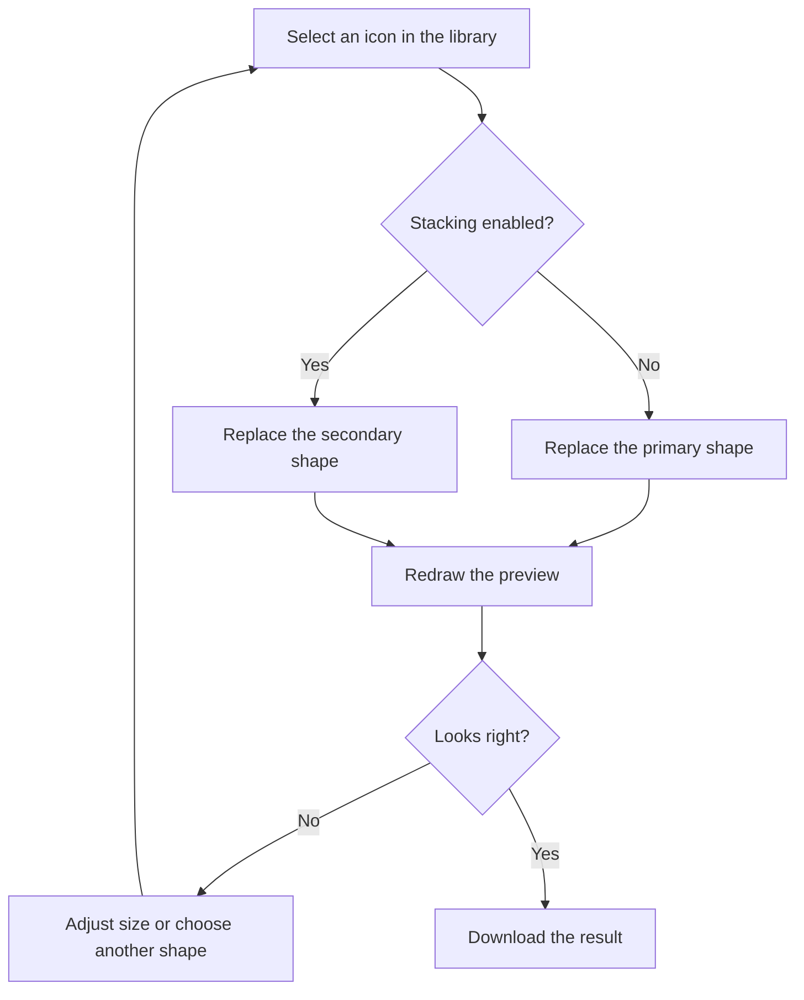

# Colors & stacking

Customize the shape you selected without leaving the studio. The preview redraws as you change colors, size, or stacking; export only after the result looks right.

## Set foreground and background colors

**Icon Color** controls the main glyph and the optional stacked glyph. Open its swatch to use the visual picker, or enter a hexadecimal value directly. A value such as `#a34329` is useful when you want to match an existing brand color exactly.

**Background Color** controls the canvas behind the glyph. While **Transparent background** is enabled, the background field displays `transparent` and is disabled. Turn transparency off to enable a solid background. Turning it back on removes that fill from the export.

The checkerboard in the preview indicates transparency. It is a preview aid, not a pattern embedded in the downloaded image. If you see a checkerboard in an image viewer, that viewer may be displaying transparent pixels in the same way.

| Setting                | Affects                          | Example                                  |
| ---------------------- | -------------------------------- | ---------------------------------------- |
| Icon Color             | Both glyphs                      | `#a34329` for a warm terracotta mark     |
| Background Color       | Canvas background                | `#ffffff` for a white square             |
| Transparent background | Whether the background is filled | Enabled for a shape without a solid tile |
| Icon Size              | Primary glyph scale              | 85% as a starting point                  |
| Stacked Size           | Secondary glyph scale            | A smaller shape for an interior cutout   |

## Keep the shape legible

The sliders range from 10% to 100% of the 512-pixel drawing surface. This percentage controls the font size used to draw a glyph; it is not a measurement of the visible shape’s exact bounds. Two icons at 85% can appear different in size because their glyph metrics differ.

Leave some padding around the shape. A glyph that looks attractive when large may become difficult to recognize in a narrow browser tab. Reduce detail, avoid very thin silhouettes, and test the downloaded image on the actual site.

For a transparent icon, the browser supplies the visible background. A pale shape can disappear on a light tab, while a very dark shape can disappear on dark chrome. A solid background can improve consistency, but it also makes the favicon appear as a square tile.

## Understand selection when stacking

By default, choosing an icon from the library replaces the primary shape. Enabling **Enable Stacked Icon** changes the selection target: subsequent library choices replace the secondary shape instead.



To change the primary shape again, disable stacking, choose the new primary icon, then re-enable stacking. The secondary selection remains in memory while you stay in the studio; disabling stacking hides its effect rather than replacing the secondary icon.

On phones, switch back to **Choose an icon** when you need another shape. Returning to **Customize & export** preserves the stacking setting and the current selections.

## Create a simple cutout

Try this sequence to understand the effect:

1. With stacking disabled, select a broad shape such as `circle`.
2. Enable **Enable Stacked Icon**.
3. Select `star` from the library.
4. Reduce **Stacked Size** until the star fits comfortably inside the circle.
5. Inspect the transparent overlap before downloading.

Stacking uses the canvas XOR composition mode. Pixels where both glyphs overlap become transparent; pixels covered by only one glyph remain. It is not a separately colored layer, and there are no independent positioning controls: both shapes are centered on the canvas.

Start with a transparent background when learning this effect. A solid background also participates in canvas composition, which can make XOR results less intuitive. If the result looks unexpectedly hollow or disappears, disable stacking and build the design up again from one shape.

## Preserve a design you like

There is no saved-project format or undo history. Download the result and note the settings if you want to recreate it later. For example:

```json
{
  "primaryIcon": "circle",
  "secondaryIcon": "star",
  "foreground": "#a34329",
  "background": "transparent",
  "primarySize": 85,
  "secondarySize": 45,
  "stacking": true
}
```

This is a human-readable record of settings, not a file the studio can import. Refreshing, closing the page, or navigating away resets the editor. See [exporting](exporting.md) to choose a final image format.
