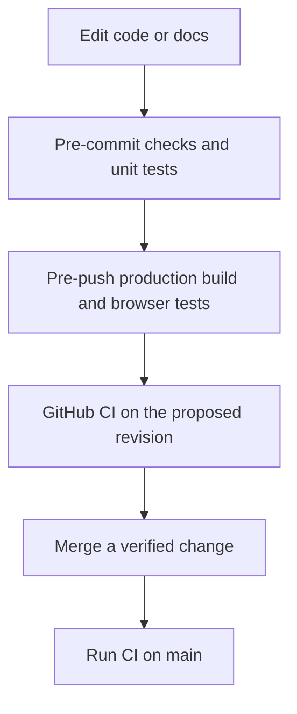

# Local development

Use the checked-in Flox environment and Bun lockfile to reproduce the toolchain used by CI. The application does not require a database or private service credentials for ordinary editing and exports.

## Install and start

Install [Flox](https://flox.dev/docs/install-flox/), then clone and enter the repository:

```sh
git clone https://github.com/nicholasadamou/iconforge.git
cd iconforge
flox activate
bun install --frozen-lockfile
bunx playwright install chromium
bun run hooks:install
bun run dev
```

Open `http://localhost:3000` for the marketing homepage, `/studio` for the editor, and `/docs` for the guides. Flox provides Bun, Node.js 24, Git, and pre-commit. The manifest and its lockfile live in `.flox/env/`; `bun.lock` records application dependencies.

Bun manages dependency installation and script execution. Next.js and Jest use Node for compatibility. Use `--frozen-lockfile` when validating an existing checkout so an installation cannot silently rewrite dependency resolutions.

If port 3000 is already occupied, choose another port rather than stopping an unrelated service:

```sh
bun run dev --port 3001
```

## Understand the repository

| Location              | Responsibility                                       |
| --------------------- | ---------------------------------------------------- |
| `app/page.tsx`        | Server-rendered marketing homepage                   |
| `app/studio/page.tsx` | Studio state and editor composition                  |
| `components/`         | Shared navigation, controls, documentation rendering |
| `hooks/`              | Search, downloads, and dynamic favicon behavior      |
| `lib/`                | Canvas drawing, ICO encoding, icon and docs catalogs |
| `docs/`               | Markdown source for the user-facing documentation    |
| `styles/`             | Shared tokens and focused page/component styles      |
| `e2e/`                | Production browser and accessibility coverage        |
| `.github/workflows/`  | CI validation and automatic releases                 |

Read [how it works](architecture.md) before changing the rendering or export path. Those changes can affect both the studio preview and the bytes saved to disk.

## Run the checks

```sh
bun run check
bun run test:ci
bun run verify:production
```

`check` runs formatting, ESLint, TypeScript, Markdown linting, Mermaid parsing, and repository budgets. `test:ci` runs the unit suite. `verify:production` creates a production build and runs Playwright against the production server, rather than relying on development-mode behavior.

The browser suite covers search, downloads, documentation routes, navigation, viewport overflow, accessibility, and copy controls. Install Chromium before running it locally. Linux runners also need the system dependencies installed by `bunx playwright install --with-deps chromium`.

To correct formatting before rerunning checks:

```sh
bun run format
bun run check
```

## Mirror CI with Git hooks

`bun run hooks:install` installs both pre-commit and pre-push hooks. Pre-commit runs static validation and unit tests; pre-push runs the production build and browser tests. A failing hook is a failed check to fix, not a reason to bypass the hook.



Run hooks without creating a commit or push when you want to reproduce their behavior:

```sh
pre-commit run --all-files
pre-commit run --all-files --hook-stage pre-push
```

## Preview a production build

```sh
bun run build
bun run start --port 3001
```

Review the homepage, studio, and a documentation page on the production server. Development mode can hide problems with static generation, missing deployment files, or metadata. Stop the server before starting another server on the same port.

Normal functionality needs no environment variables. Advanced export optionally uses `NEXT_PUBLIC_REAL_FAVICON_GENERATOR_API_KEY`. That value is browser-visible and must be configured before the build. Keep local environment files out of Git and never put a private server credential into a `NEXT_PUBLIC_` variable.

## Write documentation

Edit the Markdown files in `docs/`. The route catalog in `lib/doc-pages.ts` determines each page’s slug, title, description, group, and order. A new page needs both a Markdown file and a catalog entry. The overview uses `docs/README.md` and maps to `/docs`.

Use one H1 for the page title and H2 headings for the main topics. H2 headings become article sections and table-of-contents links, so choose distinct, descriptive headings. Links such as `exporting.md` resolve to the corresponding website documentation route.

Use fenced code blocks with a language label such as `html`, `sh`, `typescript`, or `json`. The server uses [Highlight.js](https://highlightjs.readthedocs.io/en/latest/api.html) to highlight supported languages; unrecognized languages remain readable plain text. Copy controls preserve the original code rather than copying line numbers or highlighting markup.

Use Mermaid fences for process and architecture diagrams. CI parses every Mermaid block, and the browser renders diagrams on demand with their source available in a disclosure. Include explanatory prose so the diagram is not the only way to understand a workflow.

## Keep changes small and reproducible

Authored files have a 300-line budget, and directories have a 25-file budget. Generated `lib/icons.ts`, lockfiles, and binary/font assets have explicit exclusions in `scripts/budgets.json`. Split material by responsibility rather than compressing it into unreadable lines to satisfy a budget.

The generated icon catalog is based on Font Awesome 6.5.2 metadata; the bundled version 6 font package retains those catalog entries. Run `bun run generate-icons` only for an intentional catalog update, and verify names, Unicode values, font families, and public icon counts together. Major icon-library upgrades require more than changing a dependency version.

## Understand automatic releases

A successful push-triggered CI run on `main` starts the release workflow. It checks that the tested commit is still the current `main`, then creates the next patch tag and a GitHub release with generated notes. If `main` has advanced, the older run skips release creation.

The workflow is idempotent: it reuses an existing tag for the tested revision and does not recreate a release that already exists. Pull-request CI does not publish a release. Repository content-write permission is sufficient; the workflow does not need a personal access token.
