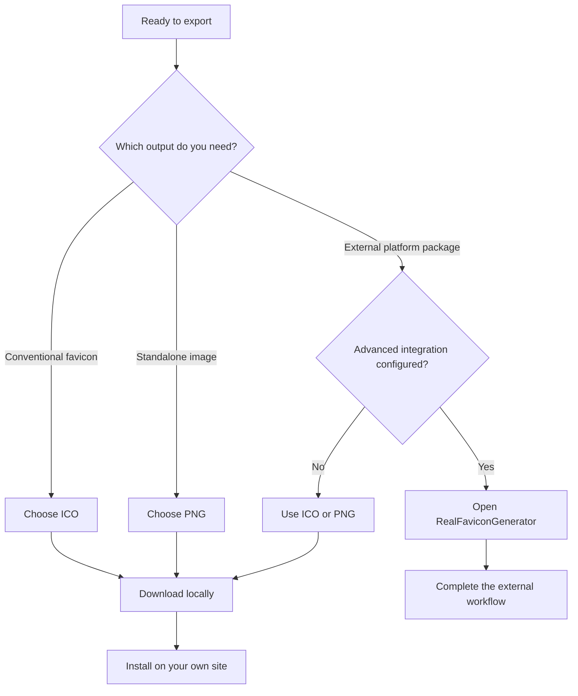

# Exporting favicons

An export turns the current canvas into a downloadable image. Choose the output format first, then install that file in your own website and verify it after deployment.

## Choose a format

| Format       | Result                                      | Processing location  | Useful when                                                  |
| ------------ | ------------------------------------------- | -------------------- | ------------------------------------------------------------ |
| ICO          | A 256 × 256 PNG-backed ICO container        | Your browser         | You need a conventional favicon file                         |
| PNG          | A 512 × 512 image with transparency support | Your browser         | You want a standard image asset                              |
| Advanced ICO | An external multi-platform favicon workflow | RealFaviconGenerator | You need a broader package and the integration is configured |

Normal ICO and PNG exports need no account or API key. ICO contains one PNG image inside an ICO container; it is not a collection of legacy bitmap sizes. PNG preserves the full 512 × 512 drawing surface.



## Download from the studio

Use the format button next to **Download** to cycle through ICO, advanced ICO, and PNG. Check its current label before downloading: clicking the format button changes the mode but does not create a file.

Select **Download** once your preview is ready. Local exports use the names `favicon.ico` and `favicon.png`; your browser may append a number when that filename already exists in the download directory. Make sure you copy the newest file into your website.

A visible error means the requested operation did not complete. The studio does not navigate away on a local download failure, so you can correct the issue and retry without deliberately discarding the current design.

## Install on a static website

Copy the ICO export into the public root of your website and reference it from the document head:

```html
<head>
  <title>My website</title>
  <link rel="icon" href="/favicon.ico" sizes="any" />
</head>
```

To use a PNG instead:

```html
<link rel="icon" type="image/png" sizes="512x512" href="/favicon.png" />
```

The URL must match the published file location. A repository directory named `public` is not normally part of the public URL: `public/favicon.png` is commonly served as `/favicon.png`. Check your framework or hosting setup rather than adding `/public` to the link automatically.

## Install in Next.js

The simplest App Router option is an ICO file at `app/favicon.ico` or `src/app/favicon.ico`. Alternatively, put the export in `public/favicon.png` and declare an icon through metadata in your website’s root layout:

```typescript
import type { Metadata } from 'next';

export const metadata: Metadata = {
  title: 'My website',
  icons: {
    icon: '/favicon.png',
  },
};
```

See the [Next.js icon conventions](https://nextjs.org/docs/app/api-reference/file-conventions/metadata/app-icons) and [metadata API](https://nextjs.org/docs/app/api-reference/functions/generate-metadata#icons) for the framework’s full options. Choose the approach that fits your existing project. Check for an old file-based icon or manual icon link if the browser appears to ignore a new metadata entry. The [quick start](quick-start.md) walks through the basic installation sequence.

## Use advanced export

Advanced export submits the current canvas image to RealFaviconGenerator and opens its workflow in another tab. The person hosting IconForge must configure `NEXT_PUBLIC_REAL_FAVICON_GENERATOR_API_KEY` before building the application.

That variable is exposed to the browser by design. It must be an integration key intended for this browser-visible workflow, not a private server credential. Changing it requires rebuilding the app. Normal ICO and PNG export work without it.

If the studio reports that advanced export is not configured, choose a local format. If a new tab opens, complete the steps provided by the external service; opening the tab alone does not mean a favicon package has been generated or installed.

## Confirm the result and handle caching

After deploying your website, open the icon URL directly and confirm it returns the right file. A request that returns HTML, a login page, or a 404 cannot serve as the intended image.

```sh
# Replace this example domain with your deployed website.
curl -I https://example.com/favicon.ico
```

A successful response is a useful first check, but inspect the image itself too. Browsers can keep an old favicon cached even after the page changes. During development, try a new filename such as `favicon-v2.png` and update the corresponding icon link. Test a new tab and check both light and dark browser chrome.
