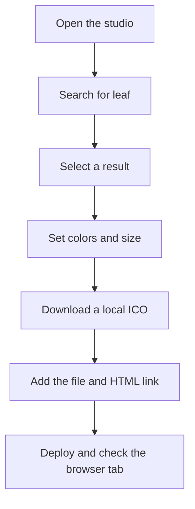

# Quick start

Create a favicon, download it, and install it on a website. This walkthrough uses a leaf icon with a transparent background; the same steps work with any shape in the catalog.

## Open the studio

Go to the [studio](/studio). You can start immediately without signing in or configuring an API key. Wait for the initial icon to appear in the live preview before exporting.

Desktop layouts show the controls and library side by side. On phones, start in **Choose an icon**, then switch to **Customize & export** after selecting a shape. The page itself stays within the viewport; the library and, on short screens, the controls scroll inside their panels.



## Choose an icon

Enter `leaf` in **Find your shape**, then select the leaf result. The preview should update, and its label should identify the selected icon. If you do not see the shape you want, try a broader word or clear the search to browse the catalog.

Use **Show more icons** to reveal another batch when browsing. Searching filters the full catalog, not just the currently displayed batch. Selecting a shape does not automatically download anything.

Brand symbols are included in the collection. Their availability does not grant permission to imply endorsement or use a trademark in a way its owner prohibits. For a personal project, a simple generic symbol is often a better starting point.

## Make it yours

For this example, keep **Transparent background** enabled and enter `#a34329` in **Icon Color**. Adjust **Icon Size** until there is clear space around the leaf. The default 85% is a starting point, not a guarantee that every glyph will fit equally well.

If you want a solid background, disable **Transparent background** and choose a background color. Keep enough contrast between the icon and its background. With a transparent export, check the icon against both light and dark browser chrome.

Leave **Enable Stacked Icon** off for your first favicon. Stacking produces a cutout effect and changes which icon a library selection replaces. The [customization guide](customization.md) explains this behavior with examples.

## Download your image

The button beside **Download** shows the selected format. It cycles in this order:

1. `.ico` — a local 256 × 256 PNG-backed ICO.
2. `.ico (advanced)` — the external favicon-generation workflow.
3. `.png` — a local 512 × 512 image.

Choose `.ico` and select **Download**. Your browser should save `favicon.ico`. If it displays an error instead, the export has not completed; follow [troubleshooting](troubleshooting.md) before leaving the studio.

Download before refreshing or navigating away. The studio does not persist editable designs across page loads.

## Add it to a plain HTML site

Put `favicon.ico` in the directory your server exposes as the root of the website. Add this line inside the document’s `<head>`:

```html
<link rel="icon" href="/favicon.ico" sizes="any" />
```

For a PNG export, copy `favicon.png` instead and use:

```html
<link rel="icon" type="image/png" sizes="512x512" href="/favicon.png" />
```

These root-relative paths assume your site serves the files at `/favicon.ico` or `/favicon.png`. If your site lives under a subdirectory, adjust the paths to match where the files are actually published.

## Add it to a Next.js site

For a Next.js App Router project, copy the ICO export to `app/favicon.ico`. Use `src/app/favicon.ico` if the application lives in a `src` directory. Keep it at the app root so Next.js can generate the favicon metadata.

```sh
# Run from your website repository, not the IconForge repository.
cp ~/Downloads/favicon.ico app/favicon.ico
```

If your project already defines icons through metadata or manual `<link>` elements, check those declarations too. Multiple conflicting icon declarations can make it unclear which file a browser will choose. See [exporting](exporting.md) for a public-directory metadata example.

## Verify the deployed result

Deploy your website, then visit the icon file URL directly. You should see the new image or receive the expected file response, not a 404 or your site’s HTML fallback page.

Open the website in a new tab and inspect the favicon at its actual tab size. If the old icon remains, try a new filename and update the reference; browsers often cache favicons separately from page content. The studio’s temporary tab preview does not change another website’s favicon automatically.
