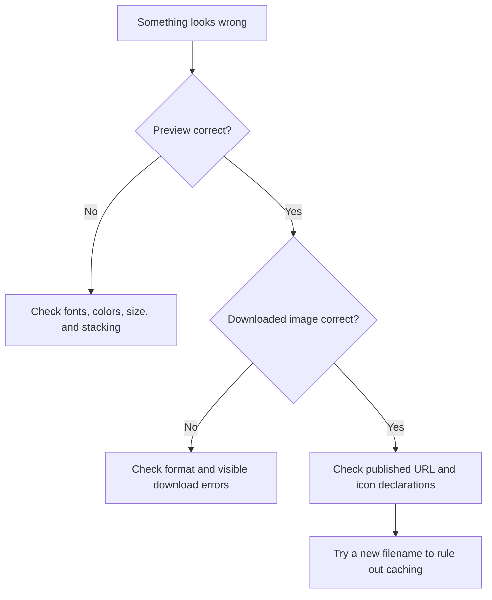

# Troubleshooting

Start by identifying where the problem appears: inside the studio preview, in a downloaded file, or on your deployed website. Each stage has a different set of likely causes.

## Choose a starting point



Do not refresh the studio as the first step if you have an unfinished design you want to keep. Its state exists only in memory. Record your settings or download a working version before investigating issues that require leaving the page.

## The preview is blank or shows a missing glyph

Wait for the bundled fonts to load, then select a familiar icon such as `star`. Check that the foreground does not match the background, and turn stacking off to rule out a cutout removing the visible shape.

If only one icon fails, record its exact name and whether it is a brand icon. If every icon fails, inspect the browser’s network panel for failed font requests. A blocked font request or an incomplete deployment can affect the entire catalog.

For a local installation, restore dependencies from the lockfile and rebuild:

```sh
flox activate
bun install --frozen-lockfile
bun run build
bun run start
```

The generated catalog’s names and Unicode values must remain supported by the installed Font Awesome fonts. The renderer also refers to the version 6 font-family names. Updating only the package to another major version can therefore break the preview even when the icon buttons still appear.

## Search returns no results

Search matches catalog labels and search terms, which may differ from the word you first try. For example, try `coffee`, `mug`, or `cup` rather than a longer phrase. Clear the search to return to the unfiltered collection.

The initial grid is a batch of results rather than the entire catalog. **Show more icons** reveals additional results. Search itself runs against the full catalog, so you do not need to load every batch before searching.

An empty search does not clear your existing design. You can continue adjusting or downloading the selected icon while trying another query.

## The wrong shape changes when I select an icon

Check **Enable Stacked Icon**. While it is enabled, selections replace the secondary shape. Disable it to change the primary shape, then enable it again if you still want the stacked effect.

On phones, the same setting remains active when you switch between **Choose an icon** and **Customize & export**. Panel switching does not reset the selection target.

## The image looks hollow or disappears

Stacking uses XOR composition, so overlapping pixels become transparent. Two similar shapes at similar sizes can cancel out most of the visible image. Turn stacking off to confirm that the primary shape is still present, then try a smaller secondary shape.

A solid background also participates in canvas composition. Begin with transparency enabled when experimenting with cutouts. See [colors and stacking](customization.md) for a circle-and-star walkthrough.

## Download fails or saves an unexpected file

Read the visible error message first. If it says the preview is not ready, wait for the preview to render before trying again. If it says advanced export is not configured, switch to normal ICO or PNG.

Verify the format label beside **Download**. The cycle is ICO, advanced ICO, then PNG. Also check the browser’s download directory: repeated downloads can produce filenames such as `favicon (1).ico`, leaving an older `favicon.ico` beside the new file.

A local download should not require permission to open an external website. Advanced export does open a new tab and may be affected by popup restrictions or network access to RealFaviconGenerator.

## The deployed favicon is still the old one

Check the file independently of the page:

```sh
# Use your real deployed URL and the filename referenced by your page.
curl -I https://example.com/favicon-v2.png
```

Then work through these checks:

1. Open the file URL in a browser and confirm the image is the new one.
2. Confirm the file was included in the deployed build, not just copied locally.
3. Inspect the page’s icon declarations for an old or conflicting URL.
4. Try a fresh filename and update the declaration to bypass the old cached URL.
5. Open a new tab or a separate browser profile to compare the result.

The dynamic favicon shown while using IconForge is only a preview for the studio tab. It does not update your website, deploy files, or modify another tab’s metadata.

## My changes disappeared

Refreshing the studio, closing its tab, or navigating to another page resets the in-memory editor state. There is no account-based recovery or saved project to restore. Switching between the two mobile panels is safe because it stays within the studio.

For future designs, download before leaving and keep a note of the icon names, colors, and slider values. An exported image cannot currently be imported back as an editable project.

## Report a reproducible issue

Open a [GitHub issue](https://github.com/nicholasadamou/iconforge/issues) with enough detail for someone else to repeat the problem:

- Browser and operating system, including whether you used a phone.
- The route, selected icon names, colors, sizes, and stacking setting.
- The selected export format and exact visible error text.
- Steps from a fresh studio page to the unexpected result.
- Whether the problem occurs in the preview, downloaded file, or deployed site.

Do not include API keys, environment-file contents, or unrelated personal information. A short sequence that reproduces the issue is more useful than a screenshot without the settings that produced it.
